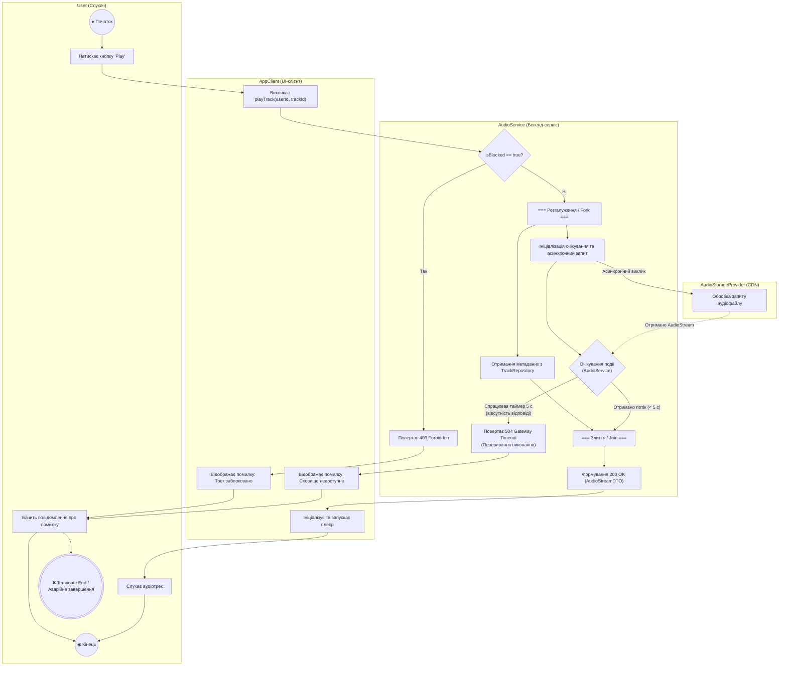

## Перший промпт 
Побудуй Activity-діаграму у форматі Mermaid Flowchart на основі спек# UC-02 "Відтворення треку"

## 1. Мета
Описати єдиний флоу запуску аудіотреку, який об'єднує відразу три сценарії: нормальне відтворення (SC-01), відмову через блокування (SC-05) та помилку таймауту від CDN (SC-02).

## 2. Формат та учасники
- **Формат:** Activity-діаграма. Вибрала цей варіант, бо GitHub нормально рендерить Mermaid-схеми в маркдауні, і зручно розбити процес на пули та намалювати паралельні завдання.
- **Пули (Swimlanes):** `User`, `AppClient`, `AudioService`, `AudioStorageProvider`.

## 3. Кроки
1. `User` натискає кнопку відтворення.
2. `AudioService` спочатку перевіряє, чи не кинув користувач цей трек у чорний список. Якщо заблоковано — процес переривається (віддаємо 403).
3. Якщо все нормально, процес роздвоюється:
   - перша гілка йде в БД за метаданими;
   - друга гілка паралельно відправляє запит до `AudioStorageProvider` за самим аудіопотоком.
4. Чекаємо на стрім. Якщо `AudioStorageProvider` не відповідає довше ніж 5 секунд — обриваємо процес по таймауту (помилка 504).
5. Якщо сховище відповіло вчасно, гілки зливаються, клієнт (`AppClient`) отримує дані й починає програвати музику.

## 4. Критерії прийняття 
- **AC-1:** На схемі є явні початковий та кінцевий вузли (Start/End).
- **AC-2:** Є блок розгалуження (if/else), де ми перевіряємо статус `isBlocked`.
- **AC-3:** Є паралельне виконання (через Fork/Join) для одночасного стягування метаданих і аудіофайлу.
- **AC-4:** На схемі показано надсилання повідомлення до іншої системи (`AudioStorageProvider`) і чітко прописана реакція на нього (або успішне отримання потоку, або помилка по таймауту).

## Відповідь АІ

flowchart TD
    subgraph User ["User (Слухач)"]
        Start((● Початок))
        PressPlay["Натискає кнопку 'Play'"]
        ViewError["Бачить повідомлення про помилку"]
        ListenAudio["Слухає аудіотрек"]
        End((◉ Кінець))
    end

    subgraph AppClient ["AppClient (UI-клієнт)"]
        SendPlayReq["Викликає playTrack(userId, trackId)"]
        ShowError403["Відображає помилку: Трек заблоковано"]
        ShowError504["Відображає помилку: Сховище недоступне"]
        RenderPlayer["Ініціалізує та запускає плеєр"]
    end

    subgraph AudioService ["AudioService (Бекенд-сервіс)"]
        CheckBlock{"isBlocked == true?"}
        Return403["Повертає 403 Forbidden"]

        Fork[=== Розгалуження / Fork ===]

        FetchMetadata["Запит метаданих з TrackRepository"]
        ReqStream["Запит аудіопотоку"]
        
        CheckTimeout{"Відповідь отримана\nпротягом 5 с?"}
        Return504["Повертає 504 Gateway Timeout"]

        Join[=== Злиття / Join ===]
        
        PrepareResponse["Формування 200 OK (AudioStreamDTO)"]
    end

    subgraph AudioStorageProvider ["AudioStorageProvider (CDN / Сховище)"]
        ProcessStreamReq["Обробка запиту та передача AudioStream"]
    end

    %% Основна послідовність дій
    Start --> PressPlay
    PressPlay --> SendPlayReq
    SendPlayReq --> CheckBlock

    %% Гілка блокування (SC-05)
    CheckBlock -- Так --> Return403
    Return403 --> ShowError403
    ShowError403 --> ViewError
    ViewError --> End

    %% Паралельне виконання (AC-3)
    CheckBlock -- Ні --> Fork
    Fork --> FetchMetadata
    Fork --> ReqStream

    %% Гілка метаданих
    FetchMetadata --> Join

    %% Гілка аудіопотоку та завантаження з CDN (AC-4, SC-02)
    ReqStream --> ProcessStreamReq
    ProcessStreamReq --> CheckTimeout

    CheckTimeout -- Ні (Таймаут >= 5с) --> Return504
    Return504 --> ShowError504
    ShowError504 --> ViewError

    %% Успішне злиття та відтворення (SC-01)
    CheckTimeout -- Так (< 5с) --> Join
    Join --> PrepareResponse
    PrepareResponse --> RenderPlayer
    RenderPlayer --> ListenAudio
    ListenAudio --> End

## Другий промпт 
Стрілка йде від ProcessStreamReq до CheckTimeout. Це неправильно, бо якщо зовнішнє сховище недоступне, стрілка від нього не прийде. Сервіс має відправити асинхронний запит, увійти у стан очікування, і вже звідти мають виходити дві події: отримання потоку АБО спрацювання таймера. Якщо стається таймаут, потік керування йде до End, але паралельна гілка `FetchMetadata` залишається заблокованою на вузлі `Join`, оскільки чекає на другу гілку, яка вже завершилась помилкою. У разі переривання процесу по таймауту, ти маєш показати, що процес повністю переривається, або використати `Terminate End`. 

Виправ код Mermaid. Для Fork/Join продовжуй використовувати вузли, але виправ потік керування так, щоб не було дедлоків, і щоб таймаут був змодельований коректно як відсутність повідомлення, а не як повідомлення від CDN.

## Друга відповідь АІ

flowchart TD
    subgraph User ["User (Слухач)"]
        Start((● Початок))
        PressPlay["Натискає кнопку 'Play'"]
        ViewError["Бачить повідомлення про помилку"]
        ListenAudio["Слухає аудіотрек"]
        EndNormal((◉ Кінець))
        EndTerminate((( ✖ Terminate End / Аварійне завершення )))
    end

    subgraph AppClient ["AppClient (UI-клієнт)"]
        SendPlayReq["Викликає playTrack(userId, trackId)"]
        ShowError403["Відображає помилку: Трек заблоковано"]
        ShowError504["Відображає помилку: Сховище недоступне"]
        RenderPlayer["Ініціалізує та запускає плеєр"]
    end

    subgraph AudioService ["AudioService (Бекенд-сервіс)"]
        CheckBlock{"isBlocked == true?"}
        Return403["Повертає 403 Forbidden"]

        Fork[=== Розгалуження / Fork ===]

        FetchMetadata["Отримання метаданих з TrackRepository"]
        
        ReqStream["Ініціалізація очікування та асинхронний запит"]
        WaitEvent{"Очікування події\n(AudioService)"}
        
        Return504["Повертає 504 Gateway Timeout\n(Переривання виконання)"]

        Join[=== Злиття / Join ===]
        
        PrepareResponse["Формування 200 OK (AudioStreamDTO)"]
    end

    subgraph AudioStorageProvider ["AudioStorageProvider (CDN)"]
        ProcessStreamReq["Обробка запиту аудіофайлу"]
    end

    %% Основний потік запуску
    Start --> PressPlay
    PressPlay --> SendPlayReq
    SendPlayReq --> CheckBlock

    %% Гілка блокування контенту (SC-05)
    CheckBlock -- Так --> Return403
    Return403 --> ShowError403
    ShowError403 --> ViewError
    ViewError --> EndNormal

    %% Паралельний потік (Fork)
    CheckBlock -- Ні --> Fork
    Fork --> FetchMetadata
    Fork --> ReqStream

    %% Паралельна гілка 1: Метадані
    FetchMetadata --> Join

    %% Паралельна гілка 2: Асинхронний запит до CDN та локальне очікування
    ReqStream -->|Асинхронний виклик| ProcessStreamReq
    ReqStream --> WaitEvent

    %% Отримання потоку від CDN (якщо CDN встигає відповісти)
    ProcessStreamReq -.->|Отримано AudioStream| WaitEvent

    %% Розгалуження подій очікування
    WaitEvent -- "Отримано потік (< 5 с)" --> Join
    WaitEvent -- "Спрацював таймер 5 с\n(відсутність відповіді)" --> Return504

    %% Гілка таймауту (SC-02) з повним перериванням процесу (Terminate End)
    Return504 --> ShowError504
    ShowError504 --> ViewError
    ViewError --> EndTerminate

    %% Успішне завершення (SC-01)
    Join --> PrepareResponse
    PrepareResponse --> RenderPlayer
    RenderPlayer --> ListenAudio
    ListenAudio --> EndNormal

## Третій промпт 
ось spec.md і Mermaid-діаграма. Виправ діаграму за spec (AC-4…AC-7, кроки 3–5):
1. Очікування в AudioService має три події: потік отримано; джерело повернуло помилку; спрацював таймер 5 с (відсутність відповіді). Усі три ведуть до Join, дострокового виходу з паралельної гілки немає.
2. Після Join додай розгалуження за результатом: потік отримано, тоді 200 OK, плеєр, End; потік не отримано, тоді помилка (для таймауту 504), AppClient показує помилку, End.
3. Прибери EndTerminate. Шляхи 403, помилки джерела і 504 ведуть до одного вузла показу помилки, з якого виходить одна стрілка до End.
4. Гілку блокування познач REQ-03/REQ-04 (UC-03), не SC-05.
Решту не змінюй. Видай повний код Mermaid. 
# UC-02 "Відтворення треку"

## 1. Мета
Описати єдиний флоу запуску аудіотреку, який об'єднує три сценарії: нормальне відтворення (SC-01), відмову через блокування (REQ-03, REQ-04) та помилку або таймаут джерела аудіо (SC-02, REQ-02).

## 2. Формат та учасники
- **Формат:** Activity-діаграма (Mermaid Flowchart). Вибрана, бо процес складається з дій чотирьох учасників (пули), розгалуження за `isBlocked`, паралельних гілок метаданих і аудіопотоку (fork/join) та очікування події з таймером. Це елементи Activity-діаграми; Mermaid Flowchart записує її текстом, що рендериться на GitHub.
- **Пули (Swimlanes):** `User`, `AppClient`, `AudioService`, `AudioStorageProvider`. `BlockService` і `TrackRepository` (окремі учасники Завд. 3) тут показані кроками всередині пулу `AudioService`: перевірка `isBlocked` і отримання метаданих.
- **Передумова:** користувач авторизований (REQ-01).

## 3. Кроки
1. `User` натискає кнопку відтворення.
2. `AudioService` перевіряє `isBlocked`: чи не заблокований трек або хтось із його виконавців (REQ-03, REQ-04; UC-03). Якщо заблоковано, віддає 403, `AppClient` показує помилку.
3. Якщо ні, процес роздвоюється (Fork):
   - перша гілка йде за метаданими (`TrackRepository`);
   - друга гілка: `AudioService` асинхронно надсилає запит `requestStream(trackId)` до `AudioStorageProvider` і переходить у стан очікування.
4. Очікування має три події: потік отримано; джерело повернуло помилку (REQ-02); спрацював таймер 5 с у `AudioService` (SC-02). Таймаут є відсутністю повідомлення від `AudioStorageProvider`, а не повідомленням від нього. Усі події ведуть до Join; з паралельної гілки немає дострокового виходу.
5. Після Join розгалуження за результатом: потік отримано, тоді `AudioService` формує 200 OK, `AppClient` запускає плеєр (SC-01); потік не отримано, тоді `AppClient` показує помилку, відтворення не починається (SC-02); для таймауту сервіс повертає 504.

## 4. Критерії прийняття
- **AC-1:** На схемі є явні початковий та кінцевий вузли (Start/End).
- **AC-2:** Є блок розгалуження (if/else), де перевіряється статус `isBlocked`.
- **AC-3:** Є паралельне виконання (Fork/Join) для одночасного отримання метаданих і аудіофайлу.
- **AC-4:** Показано повідомлення до `AudioStorageProvider` (надсилає `AudioService`, отримує `AudioStorageProvider`) і реакцію: потік отримано, помилка джерела або таймаут.
- **AC-5:** Таймаут змодельовано як подію очікування в `AudioService` (відсутність відповіді), а не як повідомлення від `AudioStorageProvider`.
- **AC-6:** Гілка очікування після помилки або таймауту доходить до Join; після Join є розгалуження за результатом.
- **AC-7:** Усі помилкові шляхи (403, помилка джерела, 504) ведуть до одного вузла показу помилки, з якого виходить одна стрілка до End.

## 5. Узгодження з попередніми моделями
- **Завд. 3 (Sequence):** `getTrackMetadata` і `requestStream` там послідовні й синхронні (sc-01, sc-02); тут паралельні й асинхронні, бо цього вимагає AC-3. 200 OK формується лише після Join. Розбіжність свідома. Таймаут 5 с і відповідь 504 збігаються з sc-02. Подія «джерело повернуло помилку» (REQ-02) у Завд. 3 не змодельована (там лише таймаут); тут вона додана за вимогою REQ-02 із Завд. 2.
- **Завд. 2 (UC-02):**

| Елемент Завд. 2 | На діаграмі |
| :-- | :-- |
| REQ-01, NFR-01, SC-01 | Основний шлях; паралельні гілки не суперечать старту потоку ≤ 2 с (NFR-01) |
| REQ-02, SC-02 | Події очікування: помилка джерела, таймер 5 с; результат «потік не отримано» |
| REQ-03, REQ-04, UC-03 (include) | Гілка `isBlocked` (трек або виконавець) з 403. Окремого Gherkin для спроби відтворити заблокований трек у Завд. 2 немає; SC-04 описує дію блокування |
| SC-05 | Свідомо не включено: це цикл по плейлісту зі `skipTrack` (Завд. 3, `loop`), а діаграма описує запуск одного треку |
| REQ-05, SC-06 | Свідомо не включено: ♥ під час відтворення це extend UC-04 (Завд. 2) |
| REQ-10, SC-14, UC-13 | Свідомо не включено: діаграма описує онлайн-запуск; офлайн-відтворення це UC-13 |

## Третя відповідь АІ
flowchart TD
    subgraph User ["User (Слухач)"]
        Start((● Початок))
        PressPlay["Натискає кнопку 'Play'"]
        ViewError["Бачить повідомлення про помилку"]
        ListenAudio["Слухає аудіотрек"]
        EndNormal((◉ Кінець))
    end

    subgraph AppClient ["AppClient (UI-клієнт)"]
        SendPlayReq["Викликає playTrack(userId, trackId)"]
        ShowError["Відображає повідомлення про помилку"]
        RenderPlayer["Ініціалізує та запускає плеєр"]
    end

    subgraph AudioService ["AudioService (Бекенд-сервіс)"]
        CheckBlock{"isBlocked == true?"}
        Return403["Повертає 403 Forbidden"]

        Fork[=== Розгалуження / Fork ===]

        FetchMetadata["Отримання метаданих з TrackRepository"]
        
        ReqStream["Ініціалізація очікування та асинхронний запит"]
        WaitEvent{"Очікування події\n(AudioService)"}

        Join[=== Злиття / Join ===]
        
        CheckStream{"Потік отримано?"}
        PrepareResponse["Формування 200 OK (AudioStreamDTO)"]
        ReturnStreamError["Повертає помилку\n(504 для таймауту / помилка джерела)"]
    end

    subgraph AudioStorageProvider ["AudioStorageProvider (CDN)"]
        ProcessStreamReq["Обробка запиту аудіофайлу"]
    end

    %% Основний потік запуску
    Start --> PressPlay
    PressPlay --> SendPlayReq
    SendPlayReq --> CheckBlock

    %% Гілка блокування контенту (REQ-03/REQ-04, UC-03)
    CheckBlock -- "Так (REQ-03/REQ-04, UC-03)" --> Return403
    Return403 --> ShowError

    %% Паралельний потік (Fork)
    CheckBlock -- Ні --> Fork
    Fork --> FetchMetadata
    Fork --> ReqStream

    %% Паралельна гілка 1: Метадані
    FetchMetadata --> Join

    %% Паралельна гілка 2: Асинхронний запит до CDN та локальне очікування
    ReqStream -->|"Асинхронний виклик requestStream(trackId)"| ProcessStreamReq
    ReqStream --> WaitEvent

    %% Відповідь від CDN (потік або помилка джерела)
    ProcessStreamReq -.->|"Потік або помилка джерела"| WaitEvent

    %% Три події очікування (усі ведуть до Join без дострокового виходу)
    WaitEvent -- "Потік отримано (< 5 с)" --> Join
    WaitEvent -- "Джерело повернуло помилку (REQ-02)" --> Join
    WaitEvent -- "Спрацював таймер 5 с\n(відсутність відповіді, SC-02)" --> Join

    %% Розгалуження після Join за результатом
    Join --> CheckStream
    CheckStream -- "Так (потік отримано)" --> PrepareResponse
    CheckStream -- "Ні (потік не отримано)" --> ReturnStreamError

    %% Єдиний вузол показу помилки (403, помилка джерела, 504)
    ReturnStreamError --> ShowError
    ShowError --> ViewError
    ViewError --> EndNormal

    %% Успішне завершення (SC-01)
    PrepareResponse --> RenderPlayer
    RenderPlayer --> ListenAudio
    ListenAudio --> EndNormal